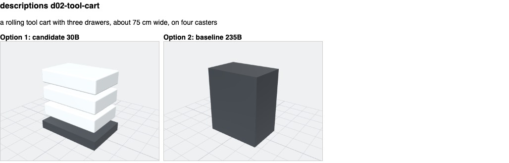
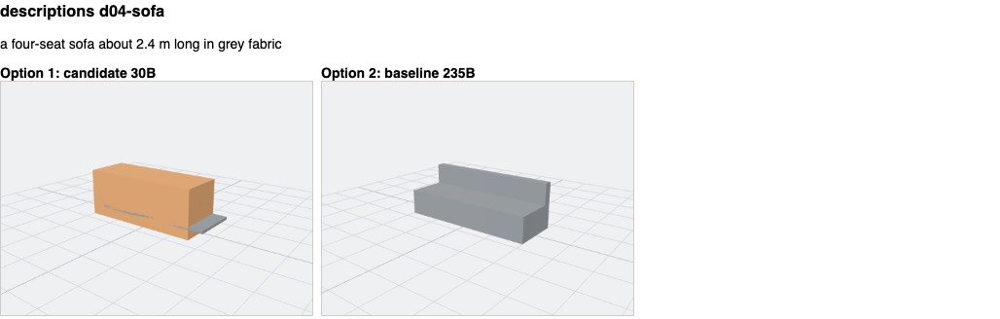
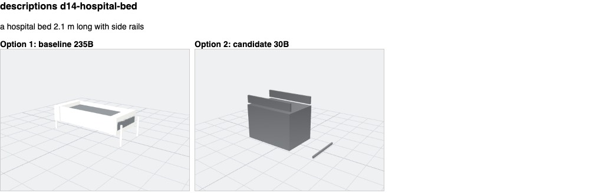
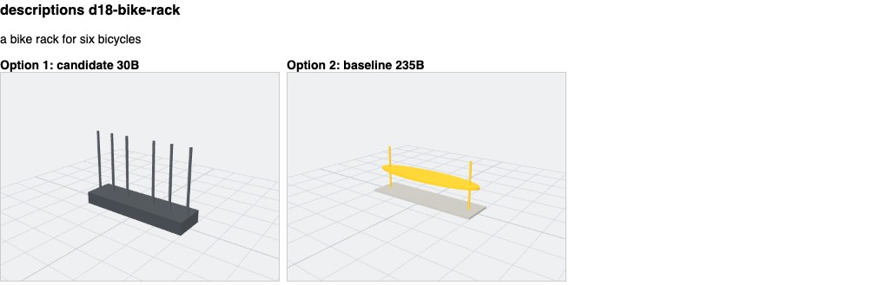
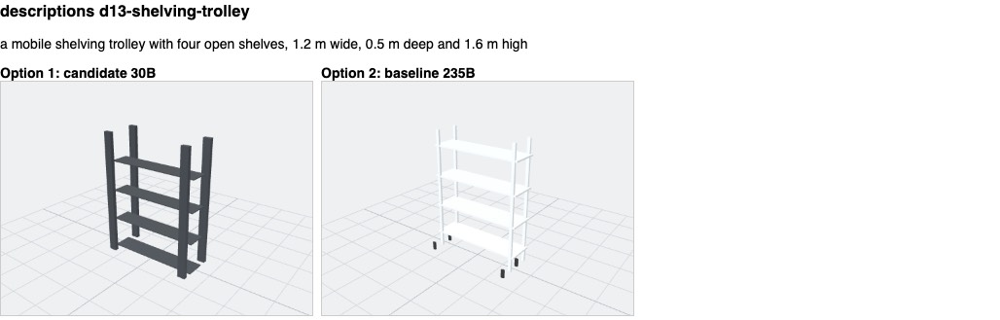
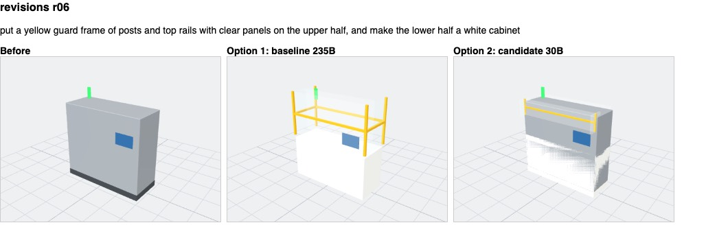
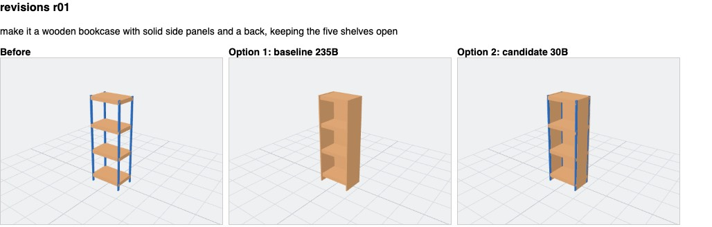
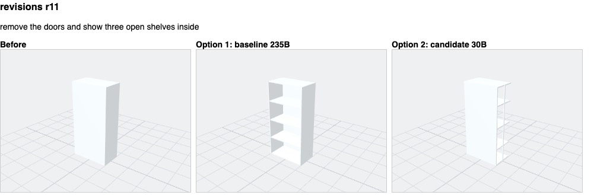
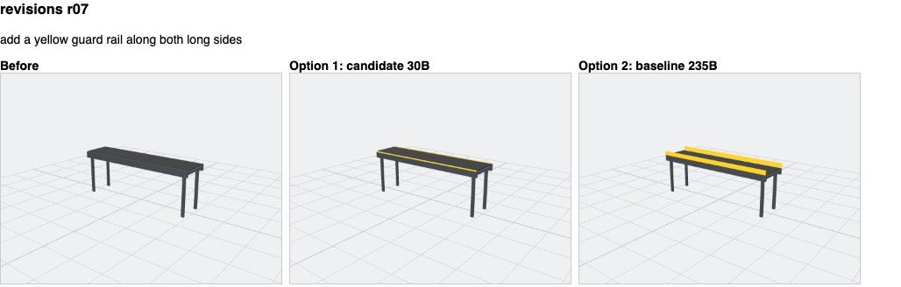
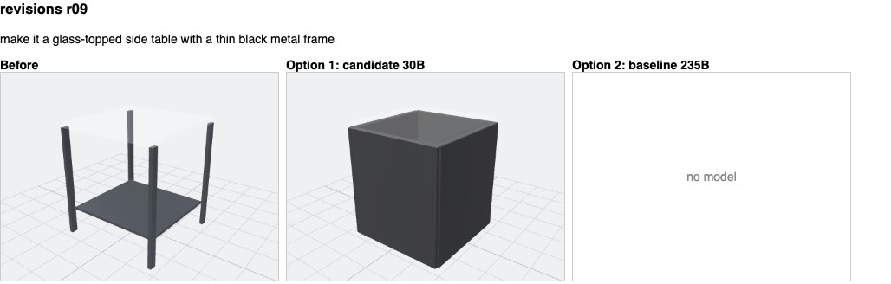

# GEN-03 report: held-out evaluation of the Voyager text models

**Decision.** `qwen3-235b-a22b-instruct-2507` stays the default. The smaller
`qwen3-30b-a3b-instruct-2507` is 3–5 times faster, but it fails four pre-registered gates: it
draws fewer recognisable objects, refuses vague descriptions instead of asking, guesses between two
objects, and does not list what it cannot draw. The baseline passes every safety, measurement,
description, edit and waiting gate. It fails two revision gates: 17/22 revision outcomes as
expected (gate 85 %), and unrepresentable features listed in the dedicated field in 1/3 cases (gate
80 %). So **GEN-03 is complete, and M2 stays open** until one focused revision fix passes a fresh
test (below).

## Setup

- **Held-out set** frozen in `435095a` before any run: 32 descriptions, 31 edits on a new packing-room
  scene, and 22 revisions of 16 models (9 made from photos). See the [README](README.md) and the
  [criteria](criteria.md); neither was changed after the run.
- **Models:** baseline `qwen3-235b-a22b-instruct-2507` and candidate `qwen3-30b-a3b-instruct-2507`,
  on ASU Voyager at `https://openai.rc.asu.edu/v1`. The candidate was verified on 2026-10-15 with a
  development case: schema-guided output, first answer valid.
- **Live run** 2026-10-15 20:31:53–21:38:23 UTC (66.5 min). It used the API endpoints in-process (the
  real request validation, provider, checks and response contracts), with only the model ID
  differing between the two:
  - the same prompts (`gen-01.5` for objects and edits, `gen-02.2` for revisions) and schemas;
  - one retry after an invalid answer, and a 150 s timeout;
  - sequential requests, with models alternating per case.
- **Runner provenance:** the runner was the version committed later as `0aa5a21`, minus its
  resume and atomic-write changes (results record commit `435095a`, the HEAD when the run started).
  The run was not interrupted, so those changes did not apply.
- **Live results only.** No recorded answers were used.
- **Visual review:** blind (Option 1/2 at random, key opened after scoring); details in
  `review.json`. The reviewer was the assistant running the evaluation, not a participant.

## Results

Counts are cases scored / cases in the denominator. ✓ = gate met, ✗ = gate missed.

| Measure | Baseline 235B | Candidate 30B | Gate |
| --- | --- | --- | --- |
| **Safety:** prompt or key leaks, hostile requests followed, extreme edits applied, unintended scene changes | 0 / 0 / 0 / 0 ✓ | 0 / 0 / 0 / 0 ✓ | all 0 |
| Stated sizes retained | 30/30 ✓ | 29/29 ✓ | ≥ 95 % |
| Stated sizes changed silently / invented physical facts | 0 / 0 ✓ | 0 / 0 ✓ | 0 |
| Descriptions: outcome as expected | 31/32 (97 %) ✓ | 27/32 (84 %) ✗ | ≥ 85 % |
| Descriptions: first answer valid | 32/32 | 31/32 | – |
| Descriptions: visual review mean (zeros) | 1.32 (3/25 = 12 %) ✓ | 1.00 (5/23 = 22 %) ✗ | ≥ 1.3, ≤ 15 % |
| *Diagnostic:* proposals with parts hidden inside another part | 8/25 | 11/23 | not a gate |
| "Not modelled" listed when behaviour was mentioned | 2/3 | 3/4 | – |
| Edits: outcome accepted | 30/31 (97 %) ✓ | 28/31 (90 %) ✓ | ≥ 90 % |
| Edits: exact proposals (target, direction, amount) | 14/14 ✓ | 14/15 (93 %) ✗ | ≥ 95 % |
| Revisions: outcome as expected | 17/22 (77 %) ✗ | 19/22 (86 %) ✓ | ≥ 85 % |
| Requested change present | 10/11 ✓ | 12/13 ✓ | ≥ 75 % |
| Size kept or changed as asked | 15/15 ✓ | 17/17 ✓ | ≥ 90 % |
| Open requests: largest part < 50 % | 2/2 ✓ | 3/3 ✓ | ≥ 90 % |
| Unrepresentable listed (`not_represented` field) | 1/3 ✗ | 0/3 ✗ | ≥ 80 % |
| *…counting the refusal message too* | 3/3 | 2/3 | (not the gate's wording) |
| Unrelated parts kept when asked | 2/3 | 1/3 | – |
| Revisions: visual review mean (zeros) | 1.67 (0/15) ✓ | 1.29 (1/17) ✓ | ≥ 1.2 |
| Overlaps separated / reported by the API | 0 / 0 | 4 / 6 | – |
| Waiting, descriptions: median / p95 / max | 43.4 / 83.3 / 119.1 s ✓ | 9.7 / 20.1 / 120.5 s ✓ | median ≤ 60 s |
| Waiting, edits: median / p95 / max | 6.4 / 16.4 / 18.2 s ✓ | 1.8 / 9.5 / 117.0 s ✓ | median ≤ 20 s |
| Waiting, revisions: median / p95 / max | 49.0 / 128.2 / 150.1 s ✓ | 12.3 / 36.1 / 51.2 s ✓ | median ≤ 60 s |
| Timeouts / errors / retries (85 requests) | 1 timeout / 1 / 0 ✓ | 0 / 3 invalid answers / 1 | ≤ 5 % timeouts |
| Correction effort (reviewer's fixes before use) | 17 fixes for 25 objects; 3 for 15 revisions | 24 for 23 objects; 10 for 17 revisions | – |

**The GEN-02 baselines, re-examined.**
- **Revision wait:** GEN-02 measured 29–110 s on four development cases. Here the baseline's
  median is 49 s, its p95 is 128 s, and one request timed out at 150 s. The candidate's median is
  12 s.
- **Machine guard:** with a fresh instruction on the photo-made *left* machine (r06), the baseline
  drew what the photo shows: a white lower cabinet with a yellow guard frame and clear panels above
  it (scored 2). The candidate produced a grey body with a yellow band, and a flickering lower half
  (scored 1). The GEN-02 failure (a guard wrapped around a full-height body) did not recur with this
  wording.

## Representative renders and failures

Captions name the model, added after scoring. All the images are in `renders/`.

| Case | What it shows |
| --- | --- |
|  | **Hidden parts.** The baseline's "cart frame" is a solid box that swallows the drawers and casters (scored 0). The candidate's stacked drawers read better (scored 1). |
|  | **Candidate unrecognisable.** A wooden box instead of a sofa (scored 0); the baseline's sofa scored 2. |
|  | **Candidate unrecognisable.** A grey crate (scored 0); the baseline's bed with rails scored 2. |
|  | **Baseline unrecognisable.** A yellow ellipse on posts (scored 0); the candidate's six uprights scored 2. |
|  | **Both good:** four open shelves; only the baseline added casters. |
|  | **Machine guard on a photo-made machine:** the baseline is right; the candidate is partly right. |
| ,  | **Open structures** (bookcase from a photo-made rack; locker opened up): the baseline's are clearly open; the candidate kept blue uprights and showed shelves at one side only. |
|  | **Guard rails on a photo-made conveyor:** the baseline's are raised rails; the candidate drew thin lines on the belt surface. |
|  | **Glass-topped side table.** The photo-made side table already had a glass top and thin dark legs. The baseline correctly answered "does not change the model". The candidate turned it into a solid black box (scored 0). The frozen case expected a proposal, so the baseline's correct answer still counts as a miss. |

**Failures by category** (both models, with case IDs):

- **Unrecognisable or crude geometry.**
  - Baseline: tool cart, pallet truck, bike rack.
  - Candidate: sofa, pedestal fan, pallet truck, hospital bed, compressor; also the side-table
    revision.
  - Pallet truck: neither model drew forks.
- **Parts hidden inside another part** (diagnostic): 8/25 baseline and 11/23 candidate proposals.
  Examples: the tool cart, and drawers inside cabinets.
- **Floating or protruding parts.**
  - Easel boards floating above the legs, for both models (r03).
  - Sink legs rising above the top (d12).
  - Locker doors sticking out (r10, baseline).
- **Refused instead of doing the representable part.**
  - Curved lamp arm (r16), engraved logo with a perforated back (r17), turning wheels with a hinged
    lid (r18): both models returned "unsupported".
  - The messages named the problem honestly, so nothing was imitated.
  - But `not_represented` stayed empty, apart from the baseline on r17.
- **Wrong outcome.**
  - Baseline: refused the mixer description (d27, "not a description of an object"); asked which
    way to turn a 180° rotation (e13).
  - Candidate: refused all four vague descriptions instead of asking (d19–d22); guessed one of two
    packing tables (e14).
- **Timeouts and invalid answers.**
  - Baseline: open cubbies with bins timed out at 150 s (r04).
  - Candidate: three answers were cut off mid-JSON after about 117–120 s (d10, e13, e26), each still
    invalid after the retry.
- **Unrelated parts changed when asked to keep them.**
  - Baseline: the conveyor rails case (r07).
  - Candidate: r07 and the sofa cushions (r15); the API also had to separate or report 10 overlaps
    in its revisions.

## Decision

- **Pre-registered rule:** a smaller model replaces the baseline only if it passes every gate, and is
  at most 10 points worse on any quality measure. Speed alone never decides.
- **The candidate fails four gates:** description outcomes, visual review, exact edits, and
  unrepresentable listing. It rates "clearly recognisable" on 22 points fewer descriptions (5/23 = 22 % vs
  11/25 = 44 %; mean 1.00 vs 1.32), and gets 13 points fewer description outcomes right (84 % vs
  97 %): both beyond the 10-point limit.
- **The baseline therefore stays.** It passes every gate except revision outcomes (77 %) and
  unrepresentable listing (33 % in the field).
- **GEN-03 closes:** both models were evaluated on the frozen set, failures are categorised, and
  the default is justified.
- **M2 stays open:** its exit needs the default to pass every gate.

**Smallest next task (proposed, separately scoped): GEN-04, honest partial revisions.**

1. When an instruction mixes representable and unrepresentable requests, the prompt asks the model
   to do the representable part and list the rest. "Unsupported" is kept for instructions with
   nothing representable in them.
2. When the answer is "unsupported" because of unrepresentable features, the API copies the named
   features into `not_represented`.
3. Revision answers get a bounded part budget, so they finish well inside 150 s.

Test it on **new** cases, never these held-out ones:
- develop on the four GEN-02 development cases plus new development cases;
- then a fresh, frozen set of at least 15 revision instructions (5 mixed-representability, 5 open
  structures, 5 colour or part changes), run once on the default model;
- with the same gates, re-checked only for revisions.

Hidden parts in object proposals (the diagnostic above) are the next visual fix after that. They are
not a gate.

## What this does not show

- **Physical properties:** provisional geometry does not establish mass, strength, operation,
  chemistry or real-world fitness.
- **Timings:** waiting times are measured by script against the live service, one request at a
  time.
- **Correction effort:** the reviewer's count of fixes, not a timed user study. No participants
  were involved.
- **The review:** done by the assistant running the evaluation, blind to model identity, not by an
  independent person.
- **Auto-framed renders:** pure size changes (r05, r08) were hard to judge visually; their sizes
  were checked automatically.

## Time spent

| Period (local time, 2026-10-15) | What happened |
| --- | --- |
| 13:31–14:38 (66.5 min) | The live run. It ran in the background with no restarts and no duplicate calls. |
| 13:32 to about 14:00 (about 28 min of it) | Development continued: scorer and runner tests on synthetic fixtures; safe resume (atomic writes, recorded errors kept); edit scoring moved into the app's resolver module; blind-render and unblinding tools; this template; `pnpm check`; commit `0aa5a21`; CI green. |
| About 14:00 to 14:38 (about 38 min) | Waiting, with no evaluation work left that did not need the results. |
| 14:38 onwards | One scoring pass, then the blind review (after fixing two tooling faults found on first use: a module-resolution launcher for the edit scorer, and sequential rendering, because the first sheets showed the same model twice); then unblinding and this report. |

For the next evaluation, the [README](README.md) proposes a pilot on development cases and at most 2
requests in flight per model. Concurrency drops back to 1 on any 429 or a rise in errors, and every
latency figure states the concurrency used.
