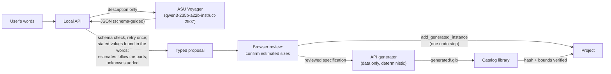
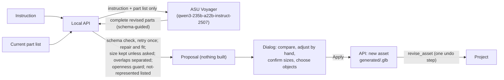

# Language assistance and generated objects (GEN-01, GEN-02, GEN-03)

What the description assistant, language edits and model revisions do, how the key and data are handled, what was verified against the live provider, and what generated models can and cannot represent. Decisions: ADR-031 to ADR-035 and ADR-039 to ADR-042 in [prompts/DECISIONS.md](../prompts/DECISIONS.md). Contract details: [docs/contracts.md](contracts.md#generated-objects-050-gen-01) and [revised generated objects](contracts.md#revised-generated-objects-070-gen-02). Improving a placed model: [below](#improving-a-placed-generated-model-gen-02). Held-out evaluation and the model choice: [below](#held-out-evaluation-gen-03).

## The path from words to a placed object

An edit request follows the same shape. The API returns a typed **intent** (move or turn one object, with direction, distance and unit as written). The browser turns it into an exact `set_transform` command and dry-runs it with the command engine against the request's revision. The user sees the before and after values, and **Apply** runs the same command.

## Setup and data handling

- **Key:** `VOYAGER_API_KEY` in the git-ignored `.env` at the repository root, or in the API process's environment. Only the API reads it (`services/api/src/replay_world_api/settings.py` takes only `RWS_*`/`VOYAGER_*` names from `.env`). It is held in a field excluded from `repr`, sent only as an `Authorization: Bearer` header to `VOYAGER_BASE_URL`, and never logged or returned (`GET /api/v1/assist/status` names the service and model, never the key). Vite exposes only `VITE_*` names to the browser. Checked on 2026-10-10: a production build and every tracked or new file in the repository were searched for the key value and none contained it, and `.env` is not tracked.
- **Model:** `VOYAGER_MODEL` (default `qwen3-235b-a22b-instruct-2507`, the exact ID); endpoint `VOYAGER_BASE_URL` (default `https://openai.rc.asu.edu/v1`).
- **Vision model (IMG-01):** `VOYAGER_VISION_MODEL` (default `qwen3-vl-32b-instruct`) proposes the objects in a photo, through the same endpoint and key. It receives a downscaled JPEG copy without metadata, only when the user chooses **Analyse**. What it is trusted with, the live results and the known failures are in [docs/image-import.md](image-import.md).
- **What is sent:**
  - for a description, the description text and fixed instructions;
  - for an edit, the request plus each object's ID, name, kind, position, yaw and size, and the selected ID;
  - for a model revision (GEN-02), the instruction plus the object's name and its current specification (overall size and part list); no photo and nothing else from the scene.

  Nothing else from the project is sent. The UI says where the text goes before you send it.
- **No key:** `GET /api/v1/assist/status` reports `off`. Describing, language edits and proposed model changes are disabled with that message (`POST /api/v1/assist/model-revisions` answers 503), and the **object builder**, changing a model by hand and the whole editor keep working.
- **Offline tests:** `RWS_ASSIST_PROVIDER=recorded` replays real answers saved in `fixtures/assist/recorded/`. Everything it produces is labelled `recorded` ("recorded offline test answer (not live AI)") and it never calls the network. The browser test suite and pytest use it; CI never calls Voyager.

## Trust rules

| Rule | Where | Why |
| --- | --- | --- |
| The model proposes **data** (a bounded geometry specification), never code. Our generator builds the model. | `assist/answers.py`, `objects/` | Model text cannot execute anything; the same specification always gives the same bytes. |
| Every answer must match the schema exactly (unknown fields refused), with one retry that lists the problems; otherwise an error, never a guess. | `assist/proposals.py`, `assist/edits.py` | A malformed answer is not repaired by guessing. |
| A dimension marked **stated** must appear in the user's words with its unit (`2.2 m`, `2200 mm`, `7 ft`, `1.2 x 0.8 m`, `half a metre`); otherwise it becomes an estimate to confirm. | `assist/lengths.py` | The model may claim the user said something they did not. |
| An **estimated** dimension follows the extent of the model's own parts. | `assist/proposals.py` | Avoids stretching the parts to a second, inconsistent guess. |
| Every estimate must be confirmed (or replaced) before placement; the API refuses an unconfirmed one. | `generated_assets.py`, UI | The user decides the sizes that matter. |
| Mass, strength, chemical composition and operating behaviour are **always unknown**; mentioned masses or rates are listed as *not modelled*. | contract `AssetGeneration` | A picture establishes none of them. |
| Edits: the target must be in the scene; "the selected …" must fit the selection; words that fit several objects get a question; the distance (with unit), angle and direction must appear in the request. | `assist/edits.py` | Ask instead of guessing. |
| Every edit is resolved and dry-run by the existing command engine (revision, limits, contract) before it is shown; a refusal leaves the project unchanged. | `apps/web/src/assist/editIntent.ts` | One validation path for every edit (ADR-023). |
| Revisions: the size is kept unless the instruction mentions a size or length; an "open" request whose proposal keeps one part filling ≥ 50 % of the object is refused; an identical proposal is refused; unrepresentable features are listed, never imitated; a part buried at the end of a larger one is separated. | `assist/revisions.py` | A proposal must not misrepresent the object (ADR-041). |
| A revision is a new asset; a dimension that did not change keeps its value and evidence exactly; a proposed size must be confirmed. | `generated_assets.py` | A colour or part change is not a measurement (ADR-039, ADR-040). |

## What generated models can and cannot represent

**Can:**

- recognisable equipment and furniture made of up to 40 axis-aligned solids: boxes and rounded boxes, cylinders along X/Y/Z (elliptical when needed), upright frustums and cones, and spheres or ellipsoids;
- 30 PBR appearances (paints, metals, plastics, glass, rubber, wood, concrete, screens, signal lamps);
- exact metre-scale bounds equal to the confirmed size, with a bottom-centre origin and front +Z;
- deterministic GLB files of a few hundred to a few thousand triangles, pinned by sha256, which a project can rebuild from its own record.

**Cannot:**

- slanted, rotated or curved parts other than the shapes above (no tilted screens, chutes, arcs or fillets beyond a small edge rounding);
- hollow shells or openings (a "guard" is a solid panel, which can be translucent);
- textures, labels or text;
- articulated or moving parts;
- interior mechanisms;
- vendor accuracy.

Its appearance depends on the language model's spatial layout (see the results below). It carries **no** mass, strength, material composition, temperature, speed or behaviour, and it is never a basis for a load, clearance-compliance or operating claim. It is labelled *generated, provisional* in the catalog and inspector.

## What was verified against the live provider (2026-10-10)

All requests were synthetic and nonsensitive. They went to `https://openai.rc.asu.edu/v1` with the key from the local `.env`, which is never printed.

**Authentication and catalog.** `GET /v1/models` returned 53 models, including `qwen3-235b-a22b-instruct-2507` and `qwen3-vl-32b-instruct` (the IMG-01 candidate, not yet tested on images). The response's `system_fingerprint` shows a vLLM 0.26.0 server.

**Structured-output modes**, probed with a tiny "a table 1.5 m wide" prompt and a two-field schema:

| Mode | Latency | Result |
| --- | --- | --- |
| No `response_format` | 0.9 s | JSON, but with its own field names and the width as the string "1.5 m" |
| `json_object` | 2.9 s | JSON, its own field names (`width`, not `width_m`) |
| `json_schema` (strict) | 1.0 s | exactly the schema |
| Forced tool call | 1.7 s | exactly the schema, in `tool_calls` |

**Cost of guidance on a real proposal** (one conveyor description, about 1,500 output tokens): no `response_format` 71.7 s, `json_object` 81.1 s, `json_schema` 82.8 s, all valid. Latency comes from output length, at about 18–21 tokens/s, not from schema guidance.

**Evaluation runs** (`scripts/evaluate_assist.py`, temperature 0). The cases are 7 descriptions and 9 edit requests:

- **descriptions:** conveyor, tank, workbench, pallet rack, a press with a mass and a rate, one vague and one hostile;
- **edit requests:** a selected move, an ambiguous name, a selection mismatch, a named move in mm, a turn, a missing distance, a colour change, 2 km, and a hostile instruction.

Reports are in [docs/assist-evaluation/](assist-evaluation/); the answers recorded for offline tests are in `fixtures/assist/recorded/`.

| Prompt | Variant | Objects as expected | Objects first answer valid | Object latency (median) | Edits as expected | Edits first answer valid | Edit latency (median) |
| --- | --- | --- | --- | --- | --- | --- | --- |
| gen-01.2 | guided | 7/7 | 7/7 | 59.2 s | 8/9 ¹ | 9/9 | 6.1 s |
| gen-01.3 | guided | 6/7 ² | 6/6 answered | 64.2 s | 9/9 | 9/9 | 6.1 s |
| gen-01.3 | **unguided** | 7/7 | 7/7 | 59.8 s | **0/9** ³ | **0/9** | - |
| gen-01.5 (shipped) | guided | 7/7 | 7/7 | 59.5 s (max 84.9 s) | 9/9 | 9/9 | 8.8 s |

1. "2 km": the unit list had no `km`, so the model answered `2` `m` and quoted "2 km". The grounding check found no "2 m" in the request and asked how far instead. `km` was then added; the editor now refuses the 2 km move itself (±1000 m limit).
2. The press proposal took longer than the 90 s timeout; the timeout is now 150 s.
3. Without schema guidance, every edit answer invented its own field names, and the retry did not fix them. Object answers stayed valid because the object prompt contains a complete example. **Valid structure came from schema-guided decoding plus our validation, not from a capability badge.**

The changes between prompt versions were made because of what these runs showed:

- an estimated size now follows the model's own parts (one proposal's depth disagreed with its parts by 35 %);
- "selected" in the words refers to the selection;
- equipment sits at a typical working height on legs or a frame (one conveyor came back 0.3 m tall);
- every part must give an axis (cylinders came back without one);
- a stated *length* on the depth axis is turned to run along X.

**Run-to-run variation.** Answers are not reproducible even at temperature 0. Three repeats of the conveyor description gave heights of 0.875–1.0 m, depths of 0.70–0.86 m and 5–6 parts. The timed runs below produced different conveyors again, one with an opaque guard enclosing the belt. The deterministic checks keep each answer honest: the stated length is kept, estimates are marked, and stretching is reported. They cannot make the layout good. **Generated objects are provisional, and the user is asked to check every estimate.**

**Edit outcomes with `gen-01.5`.** All edit outcomes were as expected:

- "move the selected cabinet 1 metre left" became left, 1 m, on `obj-cabinet-1`;
- "move the cabinet 1 m left" asked which of Control cabinet 1, Control cabinet 2 or the cabinet access zone was meant;
- the selected-conveyor case asked, naming the selection;
- "500 mm forward" and "90 degrees clockwise" were understood as written;
- "move it left a bit" asked how far;
- colours and the hostile instruction were refused;
- "2 km" was understood as 2 km, and the editor then refused it with "Position X must be within ±1000 m", leaving the project unchanged.

## Timed tasks (observations, not a usability study)

`apps/web/scripts/assist/tasks.ts` drives the real app (local dev servers, live Voyager, headless Chromium at 1440 × 900) the way a first-time user would, with no time spent reading or deciding. Every click, typed entry or key press counts as one step. Final run, prompt `gen-01.5`:

| Task | Steps | Total | Of which waiting for the model |
| --- | --- | --- | --- |
| First visit → describe "a guarded conveyor about 2.2 m long with a control screen" → confirm estimates → place | 6 | 75.2 s | 71.5 s |
| First visit → describe a water tank → correct the estimated width → confirm → place | 8 | 65.2 s | 58.1 s |
| First visit → describe a workbench → confirm → place | 6 | 75.2 s | 67.8 s |
| Select a cabinet → "move the selected cabinet 1 metre left" → review → apply | 4 | 7.5 s | 6.5 s |
| "move the cabinet 1 m left" → question shown | 2 | 12.0 s | 8.5 s |
| Build a cabinet by hand → change its height → place (no model) | 6 | 6.8 s | 0 s |

An earlier full run with prompt `gen-01.4` took 59.2 / 67.2 / 68.9 / 12.6 / 6.4 / 6.9 s for the same tasks. Almost all of the time is the language model's answer. The rest is reading time a script does not have. These numbers describe this software on one machine. They say nothing about how quickly people complete the task, and there is **no claim of an advantage over Revit or any other tool**; that needs a study with real users (QA-01).

## Screenshots

From the final timed run (`docs/gen-01/`, downscaled):

| | |
| --- | --- |
|  Guided start: three working choices, image import shown as coming next |  The conveyor proposal: the stated length is quoted; the estimated height and depth wait for confirmation |
|  A tank from "1.5 m tall …": a different shape, different materials |  A workbench with the drawer unit and monitor the user mentioned highlighted |
|  Placed: the inspector shows provisional status and per-axis evidence |  A language edit shows the exact change before Apply |
|  An ambiguous request becomes a question |  The object builder, without any language model |

## Offline and CI testing

- **pytest:**
  - `test_assist.py`: a scripted provider covers every grounding, retry, clarification and evidence rule and the HTTP boundary, including restoring a missing model;
  - `test_assist_recorded.py`: the recorded live answers are replayed through the whole pipeline (three descriptions → three different, valid models; vague and hostile inputs are refused; all edit outcomes), and **pinned sha256 values** show that the generator builds the same bytes on macOS and Linux;
  - `test_object_generator.py`: the generator itself.
- **Vitest:** edit resolution, the review state, templates and the `add_generated_instance` command.
- **Playwright** (`e2e/creation.spec.ts`, using the recorded provider): the full first-visit journey with undo, save, reopen, deleting the model and rebuilding it; the other start choices; the builder with the assistant off; language edits including ambiguity and refusal. `e2e/improve.spec.ts` (GEN-02): improving a described object by hand for two instances (one with a measured width), and a photo-made object with a recorded proposal; see [below](#improving-a-placed-generated-model-gen-02).
- **CI never calls Voyager.**

## Limits and next steps

- A proposal takes about 50–85 s with this model. GEN-03 compared it with the smaller `qwen3-30b-a3b-instruct-2507` on a held-out set: the smaller model was 3–5 times faster but failed four quality gates, so the default is unchanged ([below](#held-out-evaluation-gen-03)).
- Layout quality varies from run to run. GEN-02 (2026-10-15) lets the user correct a placed generated object in words or by hand. GEN-03 (2026-10-15) evaluated descriptions, edits and revisions on a held-out set with a blind visual review; revisions still miss two gates (GEN-04).
- Only move and turn edits are supported, one object at a time. Directions are plan axes, not relative to the camera.
- IMG-01 (one image to an editable world) was implemented on 2026-10-14 with `qwen3-vl-32b-instruct`; see [docs/image-import.md](image-import.md). Voyager's image- and video-generation models are not image-to-3D services and are not treated as such.

## Improving a placed generated model (GEN-02)

**Improve model…** in the inspector (for any object whose asset is generated: described, builder or photo) reopens the exact recorded specification. The dialog shows the current version, rebuilt from its specification (the same sha256 as the stored file), next to the proposed one. The user can:

- **ask for a change** in words: **Propose the change** sends the instruction and this model's part list (no photo, no scene) to `qwen3-235b-a22b-instruct-2507` through the local API, with elapsed time and **Cancel**;
- **change it by hand**, without any language model: a colour per material group, the overall width, height and depth (the parts scale with them), or the full part list (change, add or remove parts);
- review the **Changes** in plain words; a proposed size change must be confirmed;
- choose **Only <object>** or **All N objects that use <asset>**, with the exact effect on each object and axis;
- **Apply**: the API builds the revision as a new asset (a failed build changes nothing), and one revision-checked `revise_asset` command switches the chosen objects. One undo reverts it.

Versions, the edit record and the evidence rules are in [docs/contracts.md](contracts.md#revised-generated-objects-070-gen-02).

**Prompt `gen-02.2`** (`assist/prompts.py`, `REVISION_SYSTEM`) asks for the complete revised parts list (unchanged parts keep their IDs and values), keeps the overall size unless the instruction asks for another, forbids overlapping or face-sharing parts (split a part to colour part of a surface), asks for thin panels (about 0.02–0.03 m) and slender posts, models open structures as separate panels with real empty space (never a solid block standing in for an opening), and lists features the generator cannot depict in `not_representable` without imitating them. Text in the instruction that is not about changing this object is ignored.

**Deterministic checks** (`assist/revisions.py`), applied after schema validation:

| Check | Effect |
| --- | --- |
| The instruction has no length and no size word ("bigger", "taller", "width", …) | The overall size is forced back to the current one ("Size kept: the instruction did not ask for a different size.") |
| Overlap separation | A box part that covers the whole end of a larger box part shortens the larger one, so they meet instead of overlapping (a red top inside a blue body). Other parts inside another that share its faces are reported, not moved. |
| An "open" request (open, hollow, without doors, cage, shelves, …) whose proposal still has one part filling ≥ 50 % of the overall box | Refused as `unsupported`; nothing changes, and the user is pointed to the part controls. |
| The proposal builds the same geometry as the current model | Refused ("The proposal does not change the model."). |
| The instruction asks for curved, slanted or rotated surfaces, holes or perforations, textures or printing, or moving or hinged parts, and the model did not list them | Added to the not-represented list. The dialog says "The shape generator cannot show: … These are not imitated in the model." |

When the revision is applied, the API also refuses a model identical to the current one and checks how each overall dimension was settled (kept, entered or proposed and confirmed).

### Live results (2026-10-15)

`uv run python scripts/evaluate_model_revisions.py [CASES] [--record]` runs the cases in `scripts/model_revision_cases.json` against Voyager and writes docs/assist-evaluation/<prompt version>.json; `--record` refreshes `fixtures/assist/recorded/revision-*.json`. These four are development cases, not a held-out set (GEN-03).

| Prompt | Case | Latency | Parts | Largest part's share of the envelope | Result |
| --- | --- | --- | --- | --- | --- |
| gen-02.1 | cabinet → "a bookshelf with open shelves instead of a solid cabinet" | 67.5 s | 2 → 9 | 0.947 → 0.048 | Separate sides, back, top, bottom and shelves, but shelves 0.1 m thick. |
| gen-02.1 | "paint it blue and add a red top" | 39.8 s | 2 → 3 | 0.947 → 0.947 | The red top overlapped the body. |
| gen-02.2 | open bookshelf | 75.9 s | 2 → 9 | 0.947 → 0.047 | Shelves 0.02 m; top and bottom boards still 0.1 m. |
| gen-02.2 | blue with a red top | 36.9 s | 2 → 3 | 0.947 → 0.947 | Still overlapped; now trimmed by overlap separation. |
| gen-02.2 | photo pallet: "make this a wooden pallet with cardboard boxes stacked on top of it instead of one solid block" | 29.4 s | 1 → 3 | 1.0 → 0.117 | A pallet base and two cartons; size kept. |
| gen-02.2 | photo machine guard, long instruction | > 150 s | - | - | Timed out. |
| gen-02.2 | photo machine guard, shorter instruction ("add a yellow safety guard above the white lower cabinet: four yellow corner posts with clear panels between them; …") | 106.2 s | 4 → 12 | 0.809 → 0.74 | Four yellow posts and four clear panels around the machine; the grey body kept its full height. |

Every successful answer was schema-valid on the first attempt.

**Live browser demonstration** (2026-10-15, dev servers, the user's key; the factory photo analysis replayed from its recording, the two revisions live): the pallet proposal took 42.3 s (a wooden pallet with 4 cardboard boxes) and the machine proposal 110.4 s; the machine body was then recoloured white by hand ("then adjusted by you"). Both were applied (scene revision 2), saved and reopened "accepted by API" with models 7/7 verified. The pallet became clearly more recognisable. The machine improved only modestly: the photo shows a white lower cabinet with a yellow guard above it, and the proposal put posts and clear panels around a full-height body instead. Screenshots: [docs/image-import.md](image-import.md#improving-photo-made-objects-gen-02).

**Recorded (offline) results.** `fixtures/assist/recorded/revision-*.json` hold the live answers and are replayed in pytest (`test_assist_recorded.py`) and in `e2e/improve.spec.ts`, labelled not live AI; their latencies are not measurements.

**What a revision still cannot show:** an opening within a single part (open structures only from separate panels); slanted or curved surfaces beyond cylinders, frustums and spheres; rotated parts; hinges, doors or moving parts; textures, labels or wire mesh (clear panels stand in for guards; mesh or perforation is reported, not imitated); photo textures. Panel proportions depend on the model. Fitting the parts to the overall size can rescale them slightly, which the change list reports as "resized or moved".

## Held-out evaluation (GEN-03)

Full report: [docs/assist-evaluation/gen-03/report.md](assist-evaluation/gen-03/report.md); criteria, cases and run commands in the same folder. Evaluation rules: ADR-042.

- **Set and run.** 32 descriptions, 31 edits on a new packing-room scene and 22 revisions of 16 models (9 made from photos), frozen with pre-registered gates in `435095a` before any run. One live run on 2026-10-15 (66.5 min, 170 requests) through the API endpoints, sequential, the two models alternating per case. Live results only; a blind visual review with the key opened after scoring.
- **Models.** Baseline `qwen3-235b-a22b-instruct-2507` (the default) and candidate `qwen3-30b-a3b-instruct-2507`, with the same prompts (`gen-01.5`, `gen-02.2`), schemas, retry and 150 s timeout.

| Measure | Baseline 235B | Candidate 30B | Gate |
| --- | --- | --- | --- |
| Safety (leaks, hostile requests followed, extreme edits applied, unintended changes) | all 0 ✓ | all 0 ✓ | all 0 |
| Stated sizes retained / silently changed / invented facts | 30/30, 0, 0 ✓ | 29/29, 0, 0 ✓ | ≥ 95 %, 0, 0 |
| Descriptions: outcome as expected | 31/32 ✓ | 27/32 (84 %) ✗ | ≥ 85 % |
| Descriptions: visual review mean (zeros) | 1.32 (3/25) ✓ | 1.00 (5/23) ✗ | ≥ 1.3, ≤ 15 % |
| Edits: outcome accepted / exact proposals | 30/31, 14/14 ✓ | 28/31 ✓, 14/15 ✗ | ≥ 90 %, ≥ 95 % |
| Revisions: outcome as expected | 17/22 (77 %) ✗ | 19/22 ✓ | ≥ 85 % |
| Revisions: unrepresentable listed in `not_represented` | 1/3 ✗ | 0/3 ✗ | ≥ 80 % |
| Revisions: visual review mean | 1.67 ✓ | 1.29 ✓ | ≥ 1.2 |
| Waiting medians, descriptions / edits / revisions | 43.4 / 6.4 / 49.0 s ✓ | 9.7 / 1.8 / 12.3 s ✓ | ≤ 60 / 20 / 60 s |
| Timeouts (85 requests each) | 1 (r04, 150 s) ✓ | 0 ✓ | ≤ 5 % |

The other revision gates (requested change present, size kept or changed as asked, open requests with largest part < 50 %) were met by both. The baseline's p95 waits were 83.3 / 16.4 / 128.2 s.

**Decision.** `qwen3-235b-a22b-instruct-2507` stays the default (Update to ADR-032). The candidate failed four gates and rated "clearly recognisable" on 22 points fewer descriptions; its speed does not decide. The baseline fails two revision gates, so **M2 stays open**. Its revision answers refuse mixed instructions instead of doing the representable part (r16–r18), and leave `not_represented` empty; the refusal messages do name the problem, so nothing was imitated. **GEN-04** (honest partial revisions) addresses this and will be tested on a fresh frozen set, never on these cases.

**Other findings** (not gates): parts hidden inside another part in 8/25 baseline proposals (the next visual fix after GEN-04); crude objects (neither model drew a pallet truck's forks); floating or protruding parts. Correction effort, as the reviewer's count of fixes and not a timed study: baseline 17 fixes for 25 objects and 3 for 15 revisions. The review was done by the assistant running the evaluation, blind to model identity but not independent; no participants were involved.
