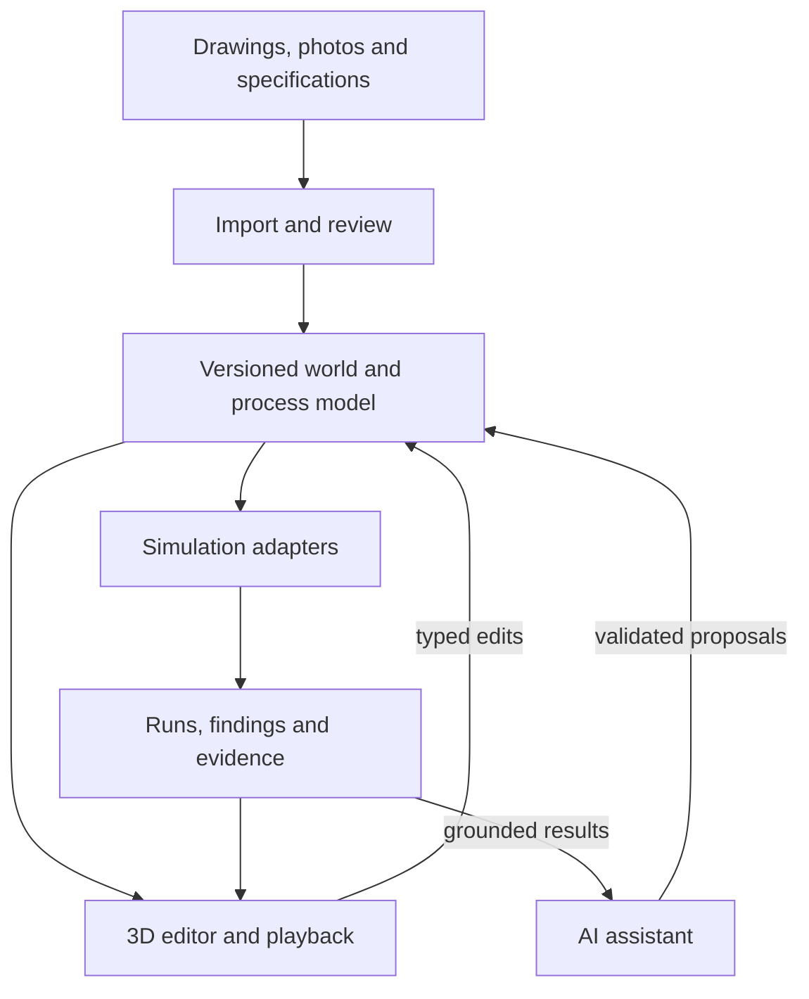

# Architecture and contracts

Architecture proposed for the first local release

The scene model is the source of truth. Rendering reads it; the editor changes it through commands; simulation runs consume immutable revisions. This prevents AI, graphics and production logic from maintaining conflicting copies.

| Boundary | Responsibility |
| --- | --- |
| Browser | 3D editor, drawing overlay, import review, playback, scenario comparison and command preview. |
| Local API | Validate commands and files, store projects, generate typed contracts, schedule jobs and expose results. |
| Worker | Run CAD parsing and production simulation outside the UI request path; persist status, logs and cancellation. |
| Simulation adapters | Declare supported questions, required inputs, outputs and validity limits. |
| AI adapter | Turn language into bounded commands; retrieve scene and result facts; never directly mutate storage. |

> Begin with one API process and one local worker, not a distributed platform. Multi-user storage, queues and remote GPU services require a later deployment decision.

## Data contracts

Versioned contracts that future applications can reuse

| Record | Minimum fields |
| --- | --- |
| Project / source | IDs, schema version, source hash, filename, units, coordinate transform, access policy and import warnings. |
| Object | Stable ID, type, asset reference, transform, dimensions, footprint, envelopes, properties and evidence links. |
| Process | Stations, directed connections, resource requirements, routing rules, buffers, timing and interruption policy. |
| Scenario | Baseline revision, changes, duration, initial state, schedule and uncertainty assumptions. |
| Run | Scene/process hashes, seed set, engine/model version, configuration, status, event log and metrics. |
| Finding | Rule/model ID, severity, affected objects, measured value, threshold, evidence and applicability limits. |

## Units and provenance

Use metres, seconds, kilograms and radians internally; show user-selected display units. Use a right-handed, Y-up world with the floor in X-Z. Store the explicit drawing-to-world transform, including orientation and axis conversion. Reject non-finite values and invalid dimensions.

A parameter carries value, unit, origin (measured, user-supplied, supplier, inferred or default), source reference, review status and optional uncertainty bounds. Unknown remains unknown. Confidence scores are only shown as probabilities if calibration supports that interpretation.

## Change and run rules

Commands have an ID, base revision and typed payload. Apply them atomically and keep an inverse operation for undo where possible. A stale base revision produces a conflict instead of overwriting another edit. Runs use immutable snapshots; scenario comparison identifies changed assumptions.

> Use one generated contract path: Pydantic models produce JSON Schema/OpenAPI and frontend types. Add contract round-trip checks so Python and TypeScript do not drift.

## Simulation contract

Production flow, geometry and motion have distinct jobs

SimPy is proposed for queues, resources and event-driven production. It is a discrete-event framework, not a structural or continuous-physics solver. Spatial checks and optional rigid-body interaction therefore live in separate adapters. [S05]

| Layer | First implementation | Boundary |
| --- | --- | --- |
| Spatial | 2D footprints and service polygons with elevation checks; specified swept envelopes. | Planar geometry alone does not establish all 3D clearances. |
| Operational | Source, processor, conveyor/transport delay, buffer, sink, resource and planned outage. | Machine internal mechanics are not inferred from the production graph. |
| Kinematic | Animate items along confirmed paths from timestamps; show machine state changes. | Visual interpolation does not alter throughput or collision outcomes. |
| Rigid-body | A later isolated interaction adapter using Rapier. | No claim of structural stress, chemical behaviour or production validity. |

## State and time

Station states: idle, processing, blocked, starved, down. Define finite buffers and blocking-after-service for the first process template. Planned downtime pauses and resumes remaining work unless the scenario explicitly chooses restart or scrap. Arrival, release and simultaneous-event ordering must be documented.

Run simulated time independently of wall-clock and renderer frame rate. Store events, then replay at any speed. Pause freezes playback; editing creates a new scenario and reruns from the defined initial state. Arbitrary mid-run branching needs engine checkpoints and is deferred.

## Outputs

Report completed units, time-weighted queue length, waiting time, resource utilization with a stated denominator, travel distance, and selected conflicts. Track created = completed + in-system + explicitly scrapped items. Distinguish an eight-hour terminating shift from steady-state experiments with warm-up.

## Proposed technology choices

Pin compatible versions during repository setup

| Part | Proposed choice | Reason / decision boundary |
| --- | --- | --- |
| Web editor | React + TypeScript + Vite; React Three Fiber / Three.js. | A browser 3D editor with typed UI code; Vite avoids unnecessary server-rendering complexity. [S06-S07] |
| Assets | glTF / GLB; Blender for asset preparation. | Portable runtime assets; catalog keeps engineering metadata separately. [S08] |
| API / contracts | Python + FastAPI + Pydantic. | Typed services near CAD and simulation tooling. [S10] |
| CAD / geometry | ezdxf + Shapely. | DXF parsing and planar spatial analysis; explicit height handling outside planar operations. [S04, S11] |
| Production | SimPy in a local worker. | Event-driven resources, queues and processes. [S05] |
| Storage | SQLite metadata + local files + immutable run directories. | Simple single-user deployment; migrate shared projects only when needed. |
| AI | Provider interface; benchmark a local text model first. | Start with typed commands. Vision models enter the import workstream after evaluation. |
| Checks | Vitest, Playwright, pytest; formatter/linter and type checks. | Critical contracts, workflows and simulation properties. |
| Later physics | Rapier for bounded rigid-body interactions. | Separate from structural and chemical analysis. Pin engine/configuration. [S12] |

## Hardware, money and operations

Use the existing workstation first. Record OS, CPU, RAM, GPU, VRAM and browser in Phase 0; benchmark before committing to local AI or large reconstructions. No paid cloud service is required for the proposed core workflow. Asset licenses, optional APIs and deployment may add cost; no spending is authorized by this plan.

Resolve supported Node and Python versions during setup and commit lockfiles. Use pnpm and uv if available; document compatible alternatives if installation is blocked. Docker is optional for repeatability after local execution works. GPU tooling and Kubernetes are not Phase 0 requirements.

## Import and asset boundaries

Reduce manual work while preserving a correction path

| Input | Initial treatment | Fallback / later work |
| --- | --- | --- |
| DXF | Parse supported layers, lines, polylines, text, dimensions and block references; review mappings. | List unsupported entities and unresolved external references. Never silently discard relevant geometry. |
| PDF / PNG | Render or show as a reference; calibrate with known dimensions; trace or place objects manually. | OCR and vector extraction after the first workflow works; retain confidence and review status. |
| DWG | Ask the user to export DXF using their existing CAD workflow. | Evaluate a licensed conversion route separately; do not imply native DWG support. The flagship journey names a DWG, so this route is IMP-04 (ADR-049). |
| Equipment CAD | Use a separately prepared GLB visual asset plus verified footprint and metadata. | A CAD conversion pipeline with licensing, units and geometry checks. |
| Machine photo or 3D model (enrichment, ENR-01) | Attach it to an existing object: better appearance; geometry accepted as checked only where the file supports it (units, bounds, footprint against the recorded one). | Placement, edits and links are kept; conflicts are shown, never averaged; the previous version is kept. |
| Supplier drawing or specification (enrichment, ENR-02) | Documented values (dimensions, height, door swing, access area) replace the estimates they cover, each citing the document. | Undocumented values stay provisional; dependent checks are marked outdated and rerun. |
| Photo / video | Store reference evidence associated with objects. | Multi-view reconstruction and object separation are an expansion workstream. |

## Import review sequence

Check modelspace units, block transforms, scale, rotation, origin and elevation. Show a drawing overlay and highlight inferred footprints. Confirm a known length and a second independent dimension where possible. Detect inconsistent labels; never average away a conflict. DXF blocks may use independent units and explicit scaling is necessary. [S04]

## Equipment catalog contract

Each entry includes a visual asset, footprint, bounds, optional collision geometry, service envelope, ports, behaviour type, editable parameters, provenance and license. Separate visual scaling from physical dimensions. Vendor assets are preferred when permitted; reusable generic machines fill gaps with explicit limits.

> An imported drawing can reveal placement and dimensions. It usually cannot establish cycle times, routing rules, maintenance procedures, structural strength, or hidden mechanisms.

## AI workflow

Useful automation with inspectable actions.

**One orchestrating agent with bounded tools** (ADR-049), not many visible agents:

- **Its tools:** identify a file, extract layout candidates, match equipment, build a draft
  world, propose changes.
- **Every tool is typed and validated.** Geometry calculations and checks are deterministic code.
- **The agent proposes; the command path applies.**
- **Every value keeps its source and uncertainty.**
- **A provisional value is never promoted to a verified one.** A check that needs it returns
  "height needed" or asks.

| Capability | How it works | When it cannot answer |
| --- | --- | --- |
| Read the world | Retrieve typed objects, dimensions, process links and source evidence. | Missing or conflicting data is reported, not invented. |
| Propose a change | Emit validated commands such as move_object, set_parameter or clone_scenario. | Unknown object, unit mismatch or unsupported operation prompts clarification. |
| Run an experiment | Select an adapter, validate required inputs and schedule a bounded job. | Missing process logic or unavailable model blocks only the affected experiment. |
| Explain a finding | Read metrics and event spans; highlight relevant objects and timeline intervals. | No numerical claim without a run/measurement reference. |
| Explore alternatives | Evaluate bounded candidate layouts against stated objectives and constraints. | Report "best among tested candidates"; do not claim a global optimum. |

## A controllable pipeline

Request -> retrieve relevant state -> build a typed proposal -> validate units, references and required inputs -> show an edit preview when needed -> execute -> summarize recorded evidence. Routine authorized runs need not introduce repeated confirmation dialogs; destructive or ambiguous edits use the normal review/undo workflow.

Start with deterministic command fixtures for testing. A mock provider must be labeled in development and cannot satisfy the AI milestone. Select a real local model after a hardware and task benchmark; keep cloud inference optional with explicit data routing. No model training from scratch is required.

## AI evaluation

Create 40 held-out requests covering valid edits, ambiguous references, impossible goals, missing values, malformed outputs and hostile instructions inside uploaded text. Score semantic correctness, clarification, numerical grounding, and unintended changes. A valid JSON response alone is insufficient.

> Uploaded documents are data. They cannot authorize shell commands, execute code, change tool policies, or request outbound transmission.

Source IDs refer to [SOURCES.md](SOURCES.md). These are design proposals to reconcile with the actual repository; exact dependency versions must be locked during setup.
